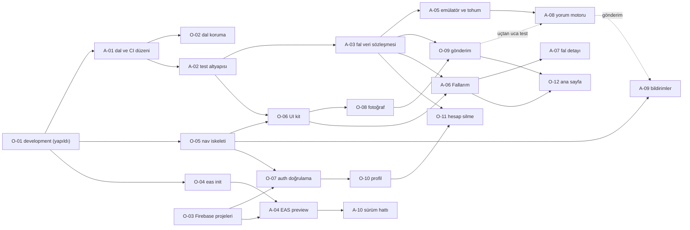

# Fallavi İş Planı

Ömer ve Abdullah için modül bazlı iş bölümü, dal (branch) stratejisi ve sürüm süreci.
Masaya oturunca adım adım ne yapılacağı: [DAL_AKISI.md](DAL_AKISI.md).

> Hazırlanma: 28 Eylül 2026 · Durum: **taslak**, iki denetçi incelemesinden sonra ayrı bir docs PR'ıyla (#1) depoya girdi.
> Kapsam: ilk sürüm (MVP, `v0.1.0`). "S-" ile başlayan kodlar 8. bölümdeki açık sorulardır.

## İçindekiler

1. [Projenin mevcut durumu](#1-projenin-mevcut-durumu)
2. [Modüller](#2-modüller)
3. [Görev dağılımı](#3-görev-dağılımı)
4. [Dal stratejisi ve günlük akış](#4-dal-stratejisi-ve-günlük-akış)
5. [PR ve review kuralları](#5-pr-ve-review-kuralları)
6. [Test ve sürüm süreci](#6-test-ve-sürüm-süreci)
7. [GitHub ayarları (depo sahibi yapar)](#7-github-ayarları-depo-sahibi-yapar)
8. [Açık sorular (Ömer'e)](#8-açık-sorular-ömere)

---

## 1. Projenin mevcut durumu

### 1.1 Uygulama ne yapıyor

Fallavi, kullanıcının Türk kahvesi fincanının fotoğrafını yükleyip fal yorumu aldığı bir mobil uygulama.
README yalnız teknik yığını anlatıyor; amaç ekran metinlerinden çıkıyor: giriş ekranında
"Fincanın dibinde ne var, birlikte bakalım.", ana ekranda "İlk falın için bir fincan fotoğrafı yükleyerek başla."

Yığın: Expo SDK 54 · React Native 0.81 (New Architecture açık) · TypeScript (strict) · expo-router (`src/app`)
· React Native Firebase 23 (Auth + Firestore) · TanStack Query · Google ve Apple ile giriş.
Firebase ücretsiz Spark planında kalacak biçimde tasarlanmış ([FIREBASE_MALIYET.md](FIREBASE_MALIYET.md)).

### 1.2 Depo durumu

- Tek commit (27 Eylül 2026, Ömer). Başta yalnız `master` dalı vardı; `development` 28 Eylül'de açıldı (O-01). İlk PR bu belgeleri ekleyen #1; issue ve CI çalışması yok.
- Depo **herkese açık** (public). Yazma yetkisi: `omerfekrem` (sahibi), `abdkisa`.
- `ios/` ve `android/` repoda yok (CNG); `npx expo prebuild --clean` ile üretilir.
- Native modüller yüzünden **Expo Go ile çalışmaz**; development build gerekir.

### 1.3 Ne hazır, ne eksik

| Alan | Durum | Not |
|---|---|---|
| Araçlar (TS strict, ESLint, Prettier, husky, commitlint, lint-staged) | Hazır | Hook'lar `npm install` ile kurulur |
| Firebase istemcisi | Kod var | 50 MB offline önbellek, emülatör bağlantısı, `getDocCacheFirst` |
| Kimlik doğrulama | Kod var, cihazda doğrulanmadı | Google + Apple (nonce), iptal yönetimi, `AuthGate` yönlendirmesi |
| Profil | Kısmi | İlk girişte `users/{uid}` yazılıyor, okuma hook'u var; ekran yok |
| Ana ekran | Yer tutucu | Karşılama metni + çıkış düğmesi |
| UI | Başlangıç | `Button`, `Screen`; tema (renk, boşluk, tipografi) |
| Firestore kuralları | Kısmi | Yalnız `users`; tanımsız her yol kapalı |
| EAS | Kısmi | 3 profil tanımlı; `projectId` yok, dev/prod ayrımı yok |
| CI | Çalışmıyor | `main`/`develop` dallarını dinliyor, depoda bu dallar yok |
| Test | Yok | Test çerçevesi ve `test` betiği yok |
| Fal gönderme, yorum, geçmiş | Yok | Uygulamanın ana özelliği; hiç kod yok |
| Bildirim, ödeme, ayarlar, hesap silme | Yok | |

### 1.4 Tespit edilen tutarsızlıklar ve riskler

| # | Tespit | Nerede | Çözen görev |
|---|---|---|---|
| 1 | `CONTRIBUTING.md` ve `ci.yml` `main`/`develop` diyor; depoda `master` var ve bu plan `master`/`development` kullanıyor. CI şu hâliyle hiçbir PR'da tetiklenmez. | `.github/workflows/ci.yml`, `CONTRIBUTING.md` | A-01 |
| 2 | CODEOWNERS'ta yer tutucu kullanıcılar (`@gelistirici1`, `@gelistirici2`). | `.github/CODEOWNERS` | A-01 |
| 3 | Görev şablonu `task` etiketini kullanıyor; depoda bu etiket yok. | `.github/ISSUE_TEMPLATE/task.md` | A-01 |
| 4 | README'de klon sonrası `cd fallavi` yazıyor, klasör `fallavi-app`; `git clone ... && cd ...` satırı Windows PowerShell 5.1'de hata verir, iki satıra bölünmeli. `npx eas build` komutu `eas-cli` bağımlılıklarda olmadığı için güvenilir değil; `npm i -g eas-cli` + `eas build` kullanılmalı. | `README.md` | A-01 |
| 5 | Hiç test yok. | — | A-02 |
| 6 | Mimari kuralın ihlali: `authService.ts` profil deposunu, ana ekran profil hook'unu doğrudan içe aktarıyor; `features/profile/index.ts` yok. | `src/features/auth/services/authService.ts`, `src/app/(app)/index.tsx` | O-07 |
| 7 | Hesap silme yok, kurallar `users` silmeyi yasaklıyor. App Store, hesap açılan uygulamalarda uygulama içinden hesap silmeyi zorunlu tutuyor. | `firebase/firestore.rules` | O-11 |
| 8 | `app.config.ts` `APP_ENV`'i kullanmıyor; `eas.json` profillerinde `environment` de yok. Bu hâliyle preview ve production aynı google-services dosyasını alır. `.env` EAS'a gitmez; `EXPO_PUBLIC_*` değerleri EAS ortam değişkeni olarak tanımlanmalı. | `app.config.ts`, `eas.json` | A-04 |
| 9 | `app.config.ts`'te EAS `projectId`/`owner` yok. | `app.config.ts` | O-04 |
| 10 | `initFirebase()` içinde `initializeFirestore` beklenmeden emülatöre bağlanılıyor. RN Firebase'de bu fonksiyon Promise döndürüyorsa ayarlar ile emülatör bağlantısı yarışabilir. **Doğrulanmalı.** | `src/lib/firebase/index.ts` | A-05 |
| 11 | `npm run emulators` `--import=./firebase/emulator-data` ile başlıyor; klasör gitignore'da, temiz klonda yok. İlk çalıştırmada hata verip vermediği **doğrulanmalı**. | `package.json` | A-05 |
| 12 | Giriş ekranındaki `https://fallavi.app/kosullar` ve `/gizlilik` bağlantılarının yayında olup olmadığı bilinmiyor. | `src/app/(auth)/login.tsx` | O-13, S-4 |
| 13 | Depo public: `.gitignore` gizli dosyaları doğru dışlıyor, ama her PR'da ayrıca kontrol edilmeli. | — | Bölüm 5 |
| 14 | Mağaza riski: App Store yönergeleri (4.3) fal uygulamalarını doymuş kategori sayıyor, benzersiz ve kaliteli deneyim sunmayanları reddediyor. | — | S-12 |
| 15 | Node sürümü sabit değil (`.nvmrc`/`engines` yok). CI Node 20 kullanıyor (desteği Nisan 2026'da bitti), Abdullah'ın makinesinde Node 24 var. Farklı npm sürümleri `package-lock.json`'u gereksiz değiştirir. | `ci.yml`, `package.json` | A-01 |
| 16 | `users` güncelleme kuralında alan beyaz listesi (`keys().hasOnly`) ve metin uzunluğu sınırı yok; kullanıcı kendi dokümanına istediği alanı yazabilir. | `firebase/firestore.rules` | A-03, O-10 |
| 17 | `app.config.ts` `./credentials/google-services.json` dosyasını istiyor. Dosya yoksa emülatörle çalışılacak olsa bile development build alınamaz; iki geliştiricinin cihazda çalışması O-03'e bağlı. | `app.config.ts` | O-03 |

---

## 2. Modüller

Her modülün bir **anahtarı** var. Aynı anahtar commit kapsamında (`feat(readings): ...`) ve dal adında
(`feature/readings-liste`) kullanılır. Klasör adları mevcut kodla uyumlu olsun diye İngilizce.

**Büyüklük:** S = yarım–1 gün · M = 2–4 gün · L = 1–2 hafta (tam zamanlı çalışma eşdeğeri).

| Anahtar | Modül | Sahibi | Büyüklük | Önce bitmesi gereken |
|---|---|---|---|---|
| `ci` | Depo, CI ve kod kalitesi | Abdullah | S | — |
| `test` | Test altyapısı | Abdullah | M | `ci` |
| `firebase` | Firebase istemcisi, tipler, güvenlik kuralları | Abdullah | M | `ci`, `test` |
| `nav` | Uygulama kabuğu ve navigasyon | Ömer | S | — |
| `ui` | Tasarım sistemi ve ortak bileşenler | Ömer | M | `nav` |
| `auth` | Kimlik doğrulama | Ömer | M | Firebase konsolu (O-03) |
| `profile` | Profil, ayarlar, hesap silme | Ömer | M | `auth`, `ui`, `readings` |
| `new-reading` | Fal gönderme | Ömer | L | `ui`, `readings`, S-2 |
| `readings` | Fal verisi, Fallarım listesi ve detay | Abdullah | M | `firebase`, `nav`, `ui` |
| `interpreter` | Fal yorum motoru (sunucu) | Abdullah | L | `readings`, S-1 (`new-reading` yalnız uçtan uca test için) |
| `notifications` | Bildirimler | Abdullah | M | `nav`; gönderim için `interpreter` |
| `home` | Ana sayfa ve ilk açılış | Ömer | M | `new-reading`, `readings` |
| `eas` | Derleme ve sürüm hattı | Abdullah | M | O-03, O-04, S-3 |
| `store` | Mağaza ve yasal hazırlık | Ömer | M | S-3, S-4 |
| `billing` | Ödeme / abonelik (MVP sonrası) | S-5'ten sonra | L | S-5 |

### MVP sonunda hedeflenen klasör yapısı

```
src/
├── app/
│   ├── _layout.tsx                  # nav (Ömer): provider'lar + AuthGate
│   ├── (auth)/login.tsx             # auth (Ömer)
│   └── (app)/
│       ├── _layout.tsx              # nav (Ömer): Stack
│       ├── (tabs)/
│       │   ├── _layout.tsx          # nav (Ömer): sekmeler
│       │   ├── index.tsx            # home (Ömer): Ana sayfa
│       │   ├── readings.tsx         # readings (Abdullah): Fallarım
│       │   └── profile.tsx          # profile (Ömer)
│       ├── reading/
│       │   ├── new.tsx              # new-reading (Ömer)
│       │   └── [id].tsx             # readings (Abdullah): fal detayı
│       └── settings/                # profile (Ömer): hesap silme vb.
├── features/
│   ├── auth/                        # Ömer
│   ├── profile/                     # Ömer
│   ├── new-reading/                 # Ömer
│   ├── readings/                    # Abdullah
│   └── notifications/               # Abdullah
├── components/ui/  theme/  providers/   # Ömer
├── lib/firebase/  config/  types/       # Abdullah
└── utils/                               # ortak
firebase/                                # Abdullah (kurallar, indeksler, kural testleri)
```

Rota adları öneridir; O-05 (navigasyon iskeleti) PR'ında kesinleşir.

### 2.1 `ci` — Depo, CI ve kod kalitesi (Abdullah)

- **Amaç:** Her PR'da typecheck, lint ve testin otomatik çalışması; commit kurallarının uygulanması.
- **Sınırlar:** `.github/`, `.husky/`, `commitlint.config.js`, `.eslintrc.js`, `.prettierrc`, `.editorconfig`, `tsconfig.json`, `.nvmrc`, `CONTRIBUTING.md`
- **Bağımlılık:** yok, ilk iş.
- **Kabul ölçütleri:** `development` ve `master`'a açılan PR'da `check` işi çalışıyor; bu dallara push'ta da çalışıyor; CODEOWNERS gerçek kullanıcıları gösteriyor; belgelerde `main`/`develop` kalmıyor; `.nvmrc` ve `package.json` `engines` var, iki geliştirici ve CI aynı Node ana sürümünü kullanıyor (öneri 24 LTS: Abdullah'ta 24 kurulu, Ömer'inkine bakılarak kesinleşir), CI sürümü `.nvmrc`'den alıyor; PR başlığı CI'da commitlint ile denetleniyor (4.3).
- **Test:** Deneme PR'ı ile CI'nın tetiklendiğini görmek; kurala aykırı commit mesajının husky tarafından reddedildiğini denemek.

### 2.2 `test` — Test altyapısı (Abdullah)

- **Amaç:** Birim, bileşen ve Firestore kural testleri için ortak altyapı.
- **Sınırlar:** jest yapılandırması, `jest.setup.ts`, `src/test-utils/`, `firebase/tests/`. Testler kodun yanında `*.test.ts(x)` olarak durur ve kodun sahibine aittir.
- **Bağımlılık:** `ci`
- **Kabul ölçütleri:** `npm test` yerelde ve CI'da geçiyor; `@react-native-firebase/*`, Google Sign-In ve Apple Authentication için mock'lar hazır; `npm run test:rules` kural testlerini emülatörde çalıştırıyor.
- **Test:** `jest-expo` + `@testing-library/react-native`; kurallar için `@firebase/rules-unit-testing` + `firebase-tools` (devDependency). Emülatör Java ister: güncel `firebase-tools` JDK 21 isterken RN 0.81 Android derlemesi JDK 17 ister; iki JDK kurulur, emülatörü çalıştıran terminalde `JAVA_HOME` 21'i gösterir (A-05 README'ye yazar; seçilen `firebase-tools` sürümüne göre doğrulanır). Kural testleri ve CI aynı sahte projeyi kullanır: `demo-fallavi` (`demo-` önekli proje internete ve kimlik bilgisine ihtiyaç duymaz). Jest ayarı `package.json` içine değil ayrı `jest.config.js` dosyasına yazılır.

### 2.3 `firebase` — Firebase istemcisi, tipler, güvenlik kuralları (Abdullah)

- **Amaç:** Firebase başlatma, ortam değişkenleri, ortak veri tipleri, koleksiyon adları, güvenlik kuralları ve indeksler için tek doğruluk kaynağı.
- **Sınırlar:** `src/lib/firebase/`, `src/config/`, `src/types/`, `firebase/`, `firebase.json`, `.firebaserc.example`, `.env.example`
- **Bağımlılık:** `ci`, `test`
- **Kabul ölçütleri:** Her koleksiyonun kuralı ve kural testi var; tanımsız yollar kapalı; yazılabilen alanlar `keys().hasOnly([...])` ile sınırlı, metin alanlarının uzunluk sınırı var; liste sorguları kural düzeyinde `limit ≤ 20` ile sınırlı; emülatör temiz klonda ilk seferde çalışıyor.
- **Kural dağıtımı:** Kural PR'ı `development`'a birleşince Abdullah `npm run deploy:rules` ile `fallavi-dev`'e yükler; `fallavi-prod`'a yalnız sürümde, `master`'dan yüklenir (6.4). S-2'de Firebase Storage seçilirse `storage.rules` ve testi de bu modüldedir.
- **Test:** Kural testleri (izin verilen ve reddedilen her durum için en az bir test); CI'da ayrı `rules` işi.

### 2.4 `nav` — Uygulama kabuğu ve navigasyon (Ömer)

- **Amaç:** Provider'lar, oturuma göre yönlendirme (`AuthGate`), sekme yapısı ve tüm MVP rotalarının iskeleti.
- **Sınırlar:** `src/app/_layout.tsx`, `src/app/(app)/_layout.tsx`, `src/app/(app)/(tabs)/_layout.tsx`, `src/app/(auth)/_layout.tsx`, `src/providers/`
- **Bağımlılık:** yok.
- **Kabul ölçütleri:** Oturum yokken her rota giriş ekranına, oturum varken sekmelere yönleniyor; tüm MVP rotaları (yer tutucu da olsa) açılıyor; her yer tutucu ekranda sahibini ve görev kodunu belirten bir yorum var. Bugünkü `src/app/(app)/index.tsx` `(tabs)/index.tsx`'e **taşınıyor** (ikisi birden kalırsa iki dosya da `/` rotasına düşer) ve `AuthGate`'teki `router.replace('/(app)')` yeni yola göre güncelleniyor.
- **Test:** `expo-router/testing-library` ile yönlendirme testi (A-02 birleşince; O-05 ondan önce biterse test ayrı küçük PR ile gelir); cihazda sekmeler arası gezinme.

### 2.5 `ui` — Tasarım sistemi ve ortak bileşenler (Ömer)

- **Amaç:** Marka dili (renk, tipografi, boşluk) ve iş mantığı içermeyen ortak bileşenler.
- **Sınırlar:** `src/theme/`, `src/components/ui/`, `assets/`
- **Bağımlılık:** `nav` (sekme ikonları)
- **Kabul ölçütleri:** Ekranlarda sabit renk ve boşluk değeri yok; her etkileşimli bileşende erişilebilirlik rolü ve etiketi var; tema koyu tek tema ise `app.config.ts`'teki `userInterfaceStyle: 'automatic'` buna göre düzeltiliyor.
- **Test:** Her bileşene render testi; UI değişen PR'da iki platformdan ekran görüntüsü.

### 2.6 `auth` — Kimlik doğrulama (Ömer)

- **Amaç:** Google ve Apple ile giriş, çıkış, oturumun korunması.
- **Sınırlar:** `src/features/auth/`, `src/app/(auth)/`
- **Bağımlılık:** Firebase konsol kurulumu (O-03); iOS kısmı için Apple Developer hesabı ve iPhone (S-3, S-7)
- **Kabul ölçütleri:** Android'de Google, iOS'ta Apple ve Google ile giriş; kullanıcı iptal ettiğinde hata gösterilmiyor; ağ hatasında anlaşılır mesaj; uygulama kapatılıp açılınca oturum korunuyor; yeni kullanıcıda `users/{uid}` bir kez yazılıyor, mevcut kullanıcıda yazma yok.
- **Test:** `useSignIn` birim testi (servisler mock'lu); cihazda elle giriş/çıkış listesi; emülatörde Auth.

### 2.7 `profile` — Profil, ayarlar, hesap silme (Ömer)

- **Amaç:** Profil görüntüleme ve düzenleme, çıkış, sürüm bilgisi, yasal bağlantılar, hesap silme.
- **Sınırlar:** `src/features/profile/`, `src/app/(app)/(tabs)/profile.tsx`, `src/app/(app)/settings/`
- **Bağımlılık:** `auth`, `ui`, `readings` (hesap silinirken fallar da silinir; silme fonksiyonu `features/readings/index.ts`'ten gelir, A-03), `firebase` (`users` için `hasOnly` alan listesi ve silme izni; kural PR'ını Abdullah yazar ya da review eder)
- **Kabul ölçütleri:** Ad değişince tüm ekranlar güncel (`invalidateQueries`); kuralların izin vermediği alan yazılmıyor; hesap silme onay ve yeniden kimlik doğrulama istiyor, sonrasında Firestore'da o kullanıcıya ait veri kalmıyor (fallar, görseller, `devices`, `users/{uid}`, Auth kullanıcısı); Apple ile girmiş kullanıcıda Apple token'ı iptal ediliyor (App Store şartı; RN Firebase `revokeToken`). İstemcide çok adımlı silme yarıda kalırsa artık veri kalır; S-1'de sunucu seçilirse silme sunucuya taşınabilir.
- **Test:** Depo fonksiyonları için birim testi; `users` silme kuralı için kural testi; silme akışı cihazda.

### 2.8 `new-reading` — Fal gönderme (Ömer)

- **Amaç:** Fincan fotoğraflarını çekme/seçme, küçültme, yükleme ve fal isteği oluşturma.
- **Sınırlar:** `src/features/new-reading/`, `src/app/(app)/reading/new.tsx` (gerekirse `reading/new/` altında adım ekranları)
- **Bağımlılık:** `ui`, `readings` (`createReading`), S-2 (görsel depolama), S-6 (fotoğraf sayısı, ek bilgi)
- **Kabul ölçütleri:** Kamera ve galeri çalışıyor; iOS izin metinleri Türkçe (`app.config.ts`, paketin `chore/deps-...` PR'ında); izin reddi anlaşılır biçimde yönetiliyor; görseller yüklenmeden önce küçültülüyor (hedef ≤ 500 KB) ve yüklenen görselde EXIF/konum bilgisi kalmıyor; bir gönderim tek fal dokümanı oluşturuyor; çift dokunuşta iki fal oluşmuyor; yükleme ilerlemesi görünüyor.
- **Test:** Küçültme ve doğrulama fonksiyonlarına birim testi; yükleyici mock'lanarak hook testi; cihazda kamera ve galeri.
- **Not:** Görsel yükleme bir arayüzün arkasında yazılır (`upload(localUri) → { path }`). S-2 cevaplanana kadar emülatörde sahte yükleyici kullanılır; iş beklemez. Fincan fotoğrafı kişisel veridir: herkese açık kalıcı URL kullanılmaz, görsele yalnız sahibi (ve yorum sunucusu) erişir. Gerçek depolamanın erişim kuralları `firebase` modülünde (Abdullah), S-2 cevabından sonra ayrı PR ile yazılır.

### 2.9 `readings` — Fal verisi, Fallarım listesi ve detay (Abdullah)

- **Amaç:** Fal dokümanlarının veri katmanı (oluşturma, listeleme, okuma, dinleme) ile Fallarım listesi ve fal detayı ekranları.
- **Sınırlar:** `src/features/readings/`, `src/types/reading.ts`, `src/app/(app)/(tabs)/readings.tsx`, `src/app/(app)/reading/[id].tsx`
- **Bağımlılık:** `firebase`, `test`, `nav`, `ui`
- **Kabul ölçütleri:** Firestore'a yalnız `services/readingRepository.ts` dokunuyor; dışarıya yalnız `index.ts` açılıyor ve Ömer'in işlerinin kullanacağı fonksiyonları A-03'te veriyor: `createReading` (O-09), liste hook'u ve sorgu anahtarı (O-12), kullanıcının tüm fallarını silme (O-11); liste 20'lik sayfalarla geliyor; detay ekranı yalnız fal beklemedeyken canlı dinliyor ve ekrandan çıkınca dinleyiciyi kapatıyor.
- **Kurallar:** İstemci yalnız kendi falını oluşturur; alanlar `hasOnly` ile sınırlı; `status == 'pending'`, `result == null`, `createdAt == request.time`; `note` uzunluğu ve `images` dizi boyu sınırlı; istemci falı güncelleyemez (`status`/`result` yalnız sunucu); sahibi silebilir (hesap silme için).
- **Test:** Depo katmanına mock'lu birim testi; kural testleri; liste için boş, dolu ve hata durumu bileşen testleri.

Önerilen veri modeli (A-03'te kesinleşir):

```
users/{uid}/readings/{readingId}
  status:    'pending' | 'processing' | 'ready' | 'failed'
  images:    string[]              // depolama yolları (S-2)
  note:      string | null         // kullanıcının niyeti/sorusu (S-6)
  createdAt: Timestamp
  readyAt:   Timestamp | null
  result:    { text: string } | null   // yalnız sunucu yazar (Admin SDK)
```

Alt koleksiyon seçildi çünkü sahiplik kuralı `isOwner(uid)` ile tek satırda yazılır ve kullanıcı silinirken
verisi tek yoldan bulunur. İstemci yalnız `status: 'pending'` ve `result: null` ile oluşturabilir; `result` alanını yalnız sunucu yazar.

### 2.10 `interpreter` — Fal yorum motoru (Abdullah)

- **Amaç:** Bekleyen falı alıp yorum üretmek ve sonucu yazmak; API anahtarlarını istemciden uzak tutmak.
- **Sınırlar:** S-1 kararına bağlı. Seçenekler: (a) ayrı depo, örneğin `fallavi-api` (.NET Web API, Natro/Plesk üzerinde; Firebase Admin SDK ile); (b) bu depoda `functions/` (Cloud Functions, Blaze planı gerekir). İstemci durumu yalnız `readings` üzerinden okur.
- **Bağımlılık:** `readings` (A-03), A-05 tohum verisi, S-1, S-2. O-09 yalnız uçtan uca test için gerekir; iş onu beklemeden başlar.
- **Kabul ölçütleri:** Firebase ID token doğrulanıyor; aynı fal iki kez işlenmiyor; kullanıcı başına günlük fal sınırı sunucuda uygulanıyor (betikle sınırsız fal açıp yapay zekâ faturasını şişirmeye karşı); hatada `status: 'failed'` ve neden yazılıyor; fal başına maliyet ölçülüyor; anahtarlar sunucu ortam değişkeninde.
- **Tetikleme:** İstemcinin sunucuyu çağırması mı, sunucunun bekleyen falları dinlemesi mi, S-1 ile birlikte kararlaştırılır. İstemci çağrısıysa fonksiyon `features/readings/index.ts`'ten verilir, O-09 onu çağırır.
- **Test:** Sunucu birim testleri; Firestore emülatörüne karşı uçtan uca deneme; aynı anda 10 fal ile yük denemesi.
- **Not:** S-1 cevaplanana kadar A-05'teki sahte yorumlayıcı betiği kullanılır, böylece detay ekranı ve bildirim akışı beklemeden geliştirilir.

### 2.11 `notifications` — Bildirimler (Abdullah)

- **Amaç:** "Falın hazır" bildirimi ve bildirime dokununca ilgili fala gitmek.
- **Sınırlar:** `src/features/notifications/`; `app.config.ts`'teki eklenti satırı (`chore/deps-...` PR'ı ile); gönderim sunucuda (`interpreter`). Bildirime dokununca yönlendirme kök düzende dinlenir: mantık bu modülde bir hook olarak yazılır, `src/app/_layout.tsx`'e yalnız çağrı satırı ayrı küçük PR ile eklenir (3.2).
- **Bağımlılık:** `nav`; istemci kısmı (izin, token kaydı, dokununca açma) Expo'nun deneme bildirimiyle A-08'i beklemeden yapılır, "falın hazır" gönderimi `interpreter`'a bağlı. iOS için APNs anahtarı (S-3).
- **Kabul ölçütleri:** İzin ilk fal gönderiminden sonra isteniyor (ilk açılışta değil); push token `users/{uid}/devices/{cihazId}` alt koleksiyonunda tutuluyor (profil dokümanına dokunmamak için) ve çıkışta siliniyor; uygulama kapalıyken bildirim geliyor; dokununca `reading/[id]` açılıyor.
- **Test:** Token kaydına birim testi; gerçek cihazda uçtan uca deneme.

### 2.12 `home` — Ana sayfa ve ilk açılış (Ömer)

- **Amaç:** Fal gönderme çağrısı, son falın durumu, kısa tanıtım ve "eğlence amaçlıdır" notu.
- **Sınırlar:** `src/app/(app)/(tabs)/index.tsx`, gerekirse `src/features/home/`
- **Bağımlılık:** `new-reading`, `readings`
- **Kabul ölçütleri:** Yeni kullanıcı iki dokunuşta fal gönderme ekranına ulaşıyor; son falın durumu, Fallarım listesiyle aynı React Query sorgu anahtarından okunuyor (ana sayfa ile Fallarım arasında geçişte ek Firestore okuması yok).
- **Test:** Boş ve dolu durum bileşen testleri; cihazda gözle kontrol.

### 2.13 `eas` — Derleme ve sürüm hattı (Abdullah)

- **Amaç:** Development, preview ve production derlemeleri; dev/prod Firebase ayrımı; mağazaya gönderim.
- **Sınırlar:** `eas.json`, `app.config.ts` (derleme ve ortam alanları), EAS ortam değişkenleri ve dosya sırları (depoda değil).
- **Bağımlılık:** O-03, O-04, S-3
- **Kabul ölçütleri:** Preview derlemesi `fallavi-dev`'e, production `fallavi-prod`'a bağlanıyor (ya `APP_ENV`'e göre dosya seçimiyle ya da `eas.json` profillerine `environment` yazıp EAS ortam değişkenlerini ortam başına tanımlayarak); Android preview APK olarak telefona doğrudan kuruluyor; EAS imza anahtarlarının SHA-1 değerleri Firebase'e ekli; `eas submit` iç test kanallarına gönderiyor.
- **Not:** Google Play'e ilk derleme Play Console'dan elle yüklenir, `eas submit` sonrakiler için çalışır. Play servis hesabı JSON'u yeni bir gizli dosyadır: depoya girmez, ortak kasada durur.
- **Test:** Her sprint sonunda preview derlemesi; sürümden önce iç test kanalında kurulum.

### 2.14 `store` — Mağaza ve yasal hazırlık (Ömer)

- **Amaç:** Mağaza varlıkları, mağaza metinleri ve yasal metinler.
- **Sınırlar:** `assets/`, `docs/store/` (mağaza metinleri); yasal sayfalar depo dışında yayınlanır (S-4).
- **Bağımlılık:** S-3, S-4; ekranların son hâli
- **Kabul ölçütleri:** Gizlilik politikası, kullanım koşulları ve KVKK aydınlatma metni yayında ve uygulamadan (giriş ekranı dahil) açılıyor; Google Play'in istediği uygulama dışından hesap silme talebi sayfası yayında; mağazaların veri güvenliği formları dolduruldu; ekran görüntüleri hazır.
- **Test:** Bağlantıların açıldığını kontrol; mağaza ön incelemesi.

### 2.15 `billing` — Ödeme / abonelik (MVP sonrası)

Gelir modeli (S-5) belli olunca ayrı plan yazılır. MVP'de yok.

---

## 3. Görev dağılımı

### 3.1 Sahiplik ilkesi

- Her klasörün **bir sahibi** var (2. bölümdeki tablo). Kendi klasöründe istediğin gibi çalışırsın.
- Başkasının klasörüne dokunman gerekirse: küçük bir düzeltmeyse ayrı küçük PR aç ve açıklamaya yaz; büyükse sahibine issue aç.
- Bir görev el değiştirirse klasör sahipliği de görevle birlikte taşınır.
- Neden bu bölüşüm: Ömer iskeleti ve arayüzü kurdu (tema, giriş ekranı), depo ve Firebase projesinin sahibi; bu yüzden kullanıcıya dönük akışlar ve konsol işleri onda. Abdullah'ın .NET/MySQL arka uç, Expo derleme ve Plesk/Natro deneyimi var; bu yüzden veri katmanı, kurallar, test/CI, EAS hattı ve sunucu tarafı yorum motoru onda. Ömer isterse görevler yer değiştirebilir.

### 3.2 Ortak dosyalar kuralı

| Dosya / klasör | Sahibi | Kural |
|---|---|---|
| `src/app/(app)/_layout.tsx`, `(tabs)/_layout.tsx` | Ömer | Tüm MVP rotaları O-05'te yer tutucu olarak açılır; sonra herkes yalnız kendi ekran dosyasını doldurur. Başlık gibi ekran ayarları düzen dosyasına değil, ekran dosyasının içine `<Stack.Screen options={...} />` ile yazılır. Yeni sekme gerekirse ayrı küçük PR. |
| `src/app/_layout.tsx` | Ömer | Bu dosyaya üç iş dokunur: O-06 (font yükleme), A-05 (`initFirebase` burada modül düzeyinde çağrılıyor), A-09 (bildirime dokununca yönlendirme). Abdullah mantığı kendi modülünde fonksiyon/hook olarak yazar, bu dosyaya yalnız çağrı satırını ayrı küçük PR ile ekler; Ömer review eder. |
| `src/theme/`, `src/components/ui/` | Ömer | Yeni ortak bileşen gerekirse önce kendi feature klasöründe yaz, sonra ayrı PR ile `ui/`'ye taşı. Yeni renk/boşluk değeri (ör. fal durum rozetinin renkleri) Ömer'e küçük PR ile eklenir; ekranda sabit değer yazılmaz. |
| `src/providers/` | Ömer | Değişiklik ayrı PR. |
| `src/types/`, `src/lib/firebase/`, `src/config/`, `firebase/` | Abdullah | Yeni koleksiyon, alan veya kural ayrı küçük PR; kural testi aynı PR'da. `src/types/user.ts`'i profil işi (Ömer) de değiştirir: küçük PR, Abdullah review eder. |
| `package.json`, `package-lock.json` | Ortak | Yeni paket `chore/deps-<paket>` PR'ı ile, `npx expo install <paket>` kullanılarak eklenir. Görevin kendisi zaten `chore` ise (ör. A-02 test altyapısı) paketler aynı PR'da gelir. Native paketse PR açıklamasına "yeni development build gerekir" yazılır. |
| `app.config.ts` | Ortak (bakımı Abdullah) | Dokunan işler: O-04 (`projectId`/`owner`), O-06 (`userInterfaceStyle`), O-08 (kamera/galeri eklentisi ve iOS izin metinleri), A-04 (ortam seçimi), A-09 (bildirim eklentisi), O-13 (ikon/splash). Eklenti satırı, onu gerektiren paketin `chore/deps-...` PR'ında eklenir. Her değişiklik küçük PR, diğerine haber verilir. |
| `eas.json` | Abdullah | Değişiklik ayrı PR. |
| Kullanıcıya görünen metinler (i18n) | — | MVP tek dil (Türkçe), çeviri altyapısı yok; metin, kullanıldığı ekran ya da feature dosyasında durur. İleride çeviri eklenirse tek ortak `tr.json` yerine feature başına dosya kullanılır (çakışmayı önlemek için). |
| `.github/`, `.husky/`, commitlint, ESLint, `tsconfig.json`, jest yapılandırması | Abdullah | Değişiklik ayrı PR. |
| `README.md`, `CONTRIBUTING.md`, `docs/` | Ortak | `docs/...` dalı ile ayrı PR. |
| `src/utils/` | Ortak | Küçük eklemeler feature PR'ında olabilir; açıklamada belirt. |

**Kural:** Ortak dosyaya dokunan PR küçük tutulur, aynı gün review edilir ve önce birleştirilir.
PR'ı açan diğerine ortak kanaldan haber verir. Diğerinin özellik dalı bunun üstüne rebase edilir.

**Sıra:** Önce temel katman birleşir (O-05 navigasyon iskeleti, A-02 test altyapısı, A-03 veri sözleşmesi),
özellikler bunların üstüne gelir.

### 3.3 Sprint takvimi

Sprint bir haftadır. Tam zamanlı çalışılmıyorsa her sprint iki hafta sayılır; önemli olan sıra (S-11).

| Sprint | Tarih (öneri) | Hedef |
|---|---|---|
| 0 | 28 Eyl – 4 Eki 2026 | Dal düzeni, CI, test altyapısı, Firebase projeleri, navigasyon iskeleti |
| 1 | 5 – 11 Eki | Temel katman: UI kit, auth doğrulama, fal veri sözleşmesi, EAS preview |
| 2 | 12 – 18 Eki | Ana özellik: fal gönderme, Fallarım listesi ve detay |
| 3 | 19 – 25 Eki | Yorum motoru, profil, hesap silme |
| 4 | 26 Eki – 1 Kas | Bildirimler, ana sayfa, mağaza hazırlığı, sürüm hattı |
| 5 | 2 – 8 Kas | `v0.1.0`: toplu test, düzeltmeler, iç test kanalları |

**İş yükü:** Görev tablosundaki büyüklüklerle (S ≈ 0,75, M ≈ 3, L ≈ 7,5 iş günü) toplam yük dengeli: Ömer ≈ 30,
Abdullah ≈ 28 iş günü. Ama takvimde **tampon yok**: Sprint 1'de ikisinin de ~7 günlük işi 5 güne sığmıyor,
Sprint 3'te Abdullah'ın L boyutlu yorum motoru tek haftaya konmuş; review, hata ve toplantı süresi hesapta yok.
Gerçekçi beklenti 6 değil 8 hafta civarı. Kayma olursa önce O-13 ve A-10 (mağaza hazırlığı) ertelenir;
çekirdek akış (giriş → fal gönder → yorum → Fallarım) korunur.

### 3.4 Görev tablosu

"—" dal sütununda: PR gerektirmeyen konsol veya ayar işi.

| ID | Görev | Sahibi | Dal | Bağımlılık | Boyut | Sprint | Kabul ölçütü |
|---|---|---|---|---|---|---|---|
| O-01 | `development` dalını `master`'dan aç. **Yapıldı (28 Eylül, PR #1 ile)** | Ömer | — | — | S | 0 | `development` GitHub'da görünüyor, `master` ile aynı commit'te |
| A-01 | Dal ve CI düzeni: `ci.yml` → `master`/`development`; CODEOWNERS → `@omerfekrem @abdkisa`; CONTRIBUTING ve README düzeltmeleri; `task` etiketi | Abdullah | `chore/ci-dal-duzeni` | O-01 (yapıldı) | S | 0 | PR'da `check` çalışıp yeşil; belgelerde `main`/`develop` kalmadı |
| O-02 | GitHub ayarları: dal koruma, birleştirme türleri, varsayılan dal (Bölüm 7) | Ömer | — | A-01 | S | 0 | Korunan dallara doğrudan push reddediliyor; onaysız PR birleşmiyor |
| O-03 | Firebase `fallavi-dev` ve `fallavi-prod`: iOS + Android uygulamaları, Google + Apple girişi, Firestore (`eur3`), kurallar yüklü; Abdullah proje üyesi; `.env` ve credentials ortak kasada. **Sprint 0'ın ilk işi:** credentials olmadan kimse development build alamaz (Tespit 17) | Ömer | — | — | M | 0 | İki geliştirici de development build'de `fallavi-dev`'e giriş yapabiliyor |
| O-05 | Navigasyon iskeleti: `(tabs)` (Ana sayfa, Fallarım, Profil) + tüm MVP rotaları için yer tutucu ekranlar; mevcut `(app)/index.tsx` `(tabs)/index.tsx`'e taşınır | Ömer | `feature/nav-sekme-iskeleti` | O-01 | S | 0 | Sekmeler ve tüm rotalar açılıyor; `/` rotasında tek ekran var; typecheck yeşil |
| A-02 | Test altyapısı: `jest-expo`, `@testing-library/react-native`, `npm test`, native modül mock'ları, CI'da test adımı | Abdullah | `chore/test-altyapisi` | A-01 | M | 0 | `npm test` yerelde ve CI'da geçiyor; en az 3 anlamlı test |
| O-04 | Expo organizasyonu (Abdullah üye) + `eas init`; `projectId`/`owner` `app.config.ts`'e | Ömer | `chore/eas-init` | O-01 | S | 1 | İki hesaptan da `eas build:list` çalışıyor |
| O-06 | UI kit: TextField, Card, LoadingView, EmptyState, ErrorState, ScreenHeader; sekme ikonları; font kararı | Ömer | `feature/ui-temel-bilesenler` | O-05, A-02 | M | 1 | Bileşenlerde sabit değer yok; her bileşenin render testi var |
| O-07 | Auth'u cihazda doğrula; `features/profile/index.ts` ile çapraz içe aktarmaları düzelt | Ömer | `fix/auth-cihaz-dogrulama` | O-03, O-05 (aynı ana ekran dosyası); iOS için S-3 | M | 1 | 2.6'daki kabul ölçütleri iki platformda sağlanıyor |
| A-03 | Fal veri sözleşmesi: `types/reading.ts`, koleksiyon, kurallar + indeks (2.9), `features/readings` depo katmanı ve `index.ts` (`createReading`, liste hook'u, kullanıcının fallarını silme), kural testleri, CI'da `rules` işi; `fallavi-dev`'e kural yükleme | Abdullah | `feature/readings-veri-sozlesmesi` | A-02 | M | 1 | Sahibi okur/oluşturur/siler, başkası okuyamaz; `limit > 20`, listede olmayan alan ve istemciden `status`/`result` yazma reddediliyor |
| A-04 | EAS preview hattı: Android APK, EAS ortam değişkenleri (`EXPO_PUBLIC_*`, dev/prod google-services dosyaları), ortam seçimi (2.13), EAS SHA-1'leri | Abdullah | `chore/eas-preview-derleme` | O-03, O-04 | M | 1 | `development`'tan alınan preview APK'da Google girişi `fallavi-dev`'e çalışıyor |
| A-05 | Emülatör düzeni: temiz klonda ilk çalıştırma, tohum verisi (1 kullanıcı + 25 fal), sahte yorumlayıcı betiği, `initFirebase` sıra kontrolü (`_layout.tsx` değişirse ayrı küçük PR, 3.2) | Abdullah | `chore/firebase-emulator-tohum` | A-03 | S | 1 | Temiz klonda `npm run emulators` hatasız; tohumla liste 2 sayfa |
| O-08 | Fal gönder, fotoğraf adımı: kamera/galeri, izinler (Türkçe iOS metinleri), önizleme, küçültme, EXIF/konum temizleme | Ömer | `feature/new-reading-fotograf` | O-06 | M | 2 | İzin reddi yönetiliyor; görsel ≤ 500 KB ve konum bilgisi yok; iki platformda çalışıyor |
| O-09 | Fal gönder, gönderim adımı: görsel yükleme (S-2), `createReading`, "gönderildi" ekranı, çift gönderim kilidi | Ömer | `feature/new-reading-gonderim` | O-08, A-03, S-2 | M | 2 | Bir gönderim = 1 fal dokümanı; ağ hatasında yarım kayıt kalmıyor |
| A-06 | Fallarım listesi: 20'lik sayfalar (`startAfter`), boş durum, çekerek yenileme | Abdullah | `feature/readings-liste` | A-03, O-06 | M | 2 | Tohum veriyle 2 sayfa; ilk açılışta ≤ 20 okuma; `onSnapshot` yok |
| A-07 | Fal detayı: durum rozeti, yorum metni, yalnız beklemedeyken tek doküman dinleyici | Abdullah | `feature/readings-detay` | A-06 | S | 2 | Sahte yorumlayıcı `ready` yapınca ekran güncelleniyor; çıkınca dinleyici kapanıyor |
| O-10 | Profil sekmesi: ad/fotoğraf, ad düzenleme, çıkış, sürüm, yasal bağlantılar | Ömer | `feature/profile-ekrani` | O-06, O-07; `users` kuralında alan beyaz listesi (Tespit 16, Abdullah'ın kural PR'ı) | M | 3 | Ad değişince ekranlar güncel; kurallar dışı alan yazılmıyor |
| O-11 | Hesap silme: onay, yeniden doğrulama; fallar, görseller, `devices`, `users/{uid}` ve Auth kullanıcısı silinir; Apple token'ı iptal edilir. Kural değişikliği (`users` silme izni) ayrı PR, Abdullah review eder | Ömer | `feature/profile-hesap-silme` + `chore/rules-hesap-silme` | O-10, A-03, S-2 | M | 3 | Silme sonrası giriş ekranı; Firestore'da kullanıcıya ait doküman kalmıyor |
| A-08 | Fal yorum motoru (sunucu) | Abdullah | S-1'e göre; bu depodaysa `feature/interpreter-ilk-surum` | A-03, A-05, S-1 (O-09 yalnız uçtan uca test için) | L | 3 | Gönderilen fal hedef sürede `ready`; hatada `failed` ve kullanıcıya mesaj; günlük fal sınırı çalışıyor |
| O-12 | Ana sayfa ve ilk açılış | Ömer | `feature/home-ana-sayfa` | O-09, A-06 | M | 4 | Yeni kullanıcı iki dokunuşta fal gönderme ekranında |
| O-13 | Mağaza ve yasal hazırlık: ikon/splash, ekran görüntüleri, yasal metinler (KVKK aydınlatma dahil), web'den hesap silme talebi sayfası, mağaza formları | Ömer | `docs/store-yasal-metinler`, `chore/store-gorseller` | S-3, S-4, S-13 | M | 4 | Uygulamadaki yasal bağlantılar açılıyor; mağaza formları dolduruldu |
| A-09 | Bildirimler: izin, token kaydı, "falın hazır" bildirimi, dokununca detay | Abdullah | `feature/notifications-fal-hazir` | O-05; gönderim için A-08 | M | 4 | Uygulama kapalıyken bildirim geliyor, doğru fal açılıyor |
| A-10 | Sürüm hattı: production profili, `eas submit`, Play iç test ve TestFlight (Play'e ilk yükleme elle) | Abdullah | `chore/eas-production` | A-04, S-3 | M | 4 | `v0.1.0` adayı iki mağazanın iç test kanalında kurulabiliyor |
| R-01 | `v0.1.0` sürümü: toplu test, düzeltmeler, sürüm PR'ı, etiket (Bölüm 6) | İkisi | `fix/...`, `chore/surum-v0.1.0` | Hepsi | M | 5 | Duman testi iki platformda geçti |

MVP sonrası (sahibi sonra belirlenir): ödeme/abonelik (S-5), App Check (mağazada herkese açılmadan önce yeniden değerlendirilir; kötüye kullanımı A-08'deki günlük sınır tek başına durdurmaz), hata izleme (Sentry ya da Crashlytics), OTA güncellemeler (`expo-updates`).

Her satır için GitHub'da görev şablonuyla bir issue açılır (görevin sahibi açar). PR'da `Closes #<no>` yazılır.

### 3.5 Bağımlılık grafiği



### 3.6 Ömer'in listesi

- **Sprint 0:** [x] O-01 `development` dalı (yapıldı, 28 Eylül, PR #1 ile) · [ ] O-03 Firebase projeleri (ilk günlerde; ikinizin de development build'i buna bağlı) · [ ] O-05 navigasyon iskeleti · [ ] O-02 dal koruma (A-01 birleşince)
- **Sprint 1:** [ ] O-04 `eas init` (sprintin ilk günü; A-04 bekliyor) · [ ] O-06 UI kit · [ ] O-07 auth doğrulama
- **Sprint 2:** [ ] O-08 fotoğraf adımı · [ ] O-09 gönderim adımı
- **Sprint 3:** [ ] O-10 profil · [ ] O-11 hesap silme
- **Sprint 4:** [ ] O-12 ana sayfa · [ ] O-13 mağaza ve yasal
- **Sprint 5:** [ ] R-01 sürüm (toplu test, iOS tarafı)
- **Sürekli:** Abdullah'ın PR'larını review; 8. bölümdeki soruları cevaplamak.

### 3.7 Abdullah'ın listesi

- **Sprint 0:** [ ] A-01 dal ve CI düzeni (ilk iş; dal `development`'tan açılır) · [ ] A-02 test altyapısı (Firebase ve cihaz gerektirmez)
- **Sprint 1:** [ ] A-03 fal veri sözleşmesi · [ ] A-04 EAS preview · [ ] A-05 emülatör ve tohum
- **Sprint 2:** [ ] A-06 Fallarım listesi · [ ] A-07 fal detayı
- **Sprint 3:** [ ] A-08 yorum motoru
- **Sprint 4:** [ ] A-09 bildirimler · [ ] A-10 sürüm hattı
- **Sprint 5:** [ ] R-01 sürüm (toplu test, Android tarafı, etiket)
- **Sürekli:** Ömer'in PR'larını review.

---

## 4. Dal stratejisi ve günlük akış

### 4.1 Dallar

| Dal | Nereden açılır | Nereye birleşir | Nasıl birleşir | Kim |
|---|---|---|---|---|
| `master` | — | — | Yalnız PR ile; doğrudan push yasak | Yayına çıkan sürüm |
| `development` | `master` (bir kez) | `master` | Sürüm PR'ı, **merge commit** | Entegrasyon ve toplu test |
| `feature/*` | `development` | `development` | **Squash and merge** | Yeni özellik |
| `fix/*` | `development` | `development` | Squash and merge | `development`'taki hata |
| `chore/*` | `development` | `development` | Squash and merge | Bağımlılık, yapılandırma, CI |
| `docs/*`, `refactor/*`, `test/*` | `development` | `development` | Squash and merge | Belge, yeniden düzenleme, test |
| `hotfix/*` | `master` | `master` | Merge commit | Yayındaki acil hata |
| `chore/*-geri-al` | `development` | `development` | Merge commit | Hotfix'i `development`'a geri taşımak (4.7) |

**Neden sürüm PR'ı squash değil:** `development` → `master` squash edilirse iki dalın geçmişi ayrışır ve
bir sonraki sürüm PR'ında aynı değişiklikler yeniden çakışma olarak gelir. Merge commit geçmişi ortak tutar.
GitHub son kullanılan birleştirme türünü hatırlar: sürüm ve geri alma PR'larında düğmenin yanındaki oktan
*Create a merge commit* seçildiğini kontrol et.

### 4.2 Dal adları

Biçim: `<tür>/<modül>-<kısa-ad>`. Küçük harf, tire ile ayrılmış, **Türkçe karakter yok** (ç→c, ğ→g, ı→i, ö→o, ş→s, ü→u).

```
feature/readings-liste
feature/new-reading-fotograf
fix/auth-apple-iptal
chore/deps-expo-image-picker
docs/is-plani-guncelleme
hotfix/auth-android-crash
```

Tür, commit türüyle eşleşir: `feature/` → `feat`, `fix/` ve `hotfix/` → `fix`, `chore/` → `chore` (yalnız CI dosyası değiştiyse `ci`), `docs/` → `docs`, `refactor/` → `refactor`, `test/` → `test`.
Modül, commit kapsamıdır: `feature/readings-liste` dalındaki commit `feat(readings): ...` olur.
`chore/` ve `docs/` dallarında modül yerine konu da yazılabilir (`deps`, `surum`, `ci`).
commitlint dal adını denetlemez, yalnız commit mesajını denetler; bu eşleşme bir ekip kuralıdır.

**Kişi öneki (`omer/feature/...`) kullanmıyoruz.** Gerekçe:
- Sahiplik zaten görev tablosunda, PR yazarında ve atanan kişide görünüyor.
- İki kişi aynı modülde paralel çalışmıyor; çakışmayı önleyen şey klasör sahipliği, dal adı değil.
- Görev el değiştirirse dal adını değiştirmek gerekmez.
- Kendi dallarını görmek için: `git branch -r --list "origin/*" --format="%(refname:short) %(authorname)"` ya da GitHub'da `author:@me` filtresi.

### 4.3 Başlangıç kurulumu (bir kez)

Sıra önemli: CI önce `development`'ı tanımalı, dal koruması en son açılmalı (`check` işinin listede görünmesi için en az bir kez çalışmış olması gerekir).

1. **O-01, yapıldı (28 Eylül, PR #1 ile):** `development` dalı `master`'dan açıldı. Bu iki belge de ayrı bir docs PR'ıyla (#1) girdi.
2. **Abdullah (A-01):** `chore/ci-dal-duzeni` dalında `ci.yml`, CODEOWNERS, CONTRIBUTING ve README'yi düzeltir, `development`'a PR açar. Ömer onaylar, Abdullah birleştirir.
3. **Ömer (O-02):** Bölüm 7'deki GitHub ayarlarını açar.
4. **İkisi:** `git fetch --prune origin` (önceden klonlanmış depo `development`'ı ancak böyle görür), ilk kurulum (README'deki "İlk kurulum" bölümü), sonra development build (O-03'ün credentials dosyaları gerekir).

`ci.yml` için gereken değişiklik (A-01):

```yaml
on:
  pull_request:
    branches: [master, development]
  push:
    branches: [master, development]
```

`check` işinde `node-version: 20` yerine `node-version-file: .nvmrc` kullanılır.

PR başlığı ayrı bir iş akışında denetlenir (`.github/workflows/pr-title.yml`). Ayrı dosya olmasının
nedeni: başlık düzeltilince (`edited`) yalnız bu iş yeniden çalışır, `check` her açıklama düzenlemesinde
baştan kurulmaz. Başlık `run` satırına doğrudan yazılmaz, ortam değişkeniyle verilir (depo public; başlığa
komut gömülmesini önler):

```yaml
name: PR başlığı
on:
  pull_request:
    branches: [master, development]
    types: [opened, edited, synchronize, reopened]
jobs:
  pr-title:
    runs-on: ubuntu-latest
    steps:
      - uses: actions/checkout@v4
      - uses: actions/setup-node@v4
        with:
          node-version-file: .nvmrc
          cache: npm
      - run: npm ci
      - run: echo "$PR_TITLE" | npx commitlint
        env:
          PR_TITLE: ${{ github.event.pull_request.title }}
```

`pr-title` de bir kez çalıştıktan sonra zorunlu kontrollere eklenir.

CI bu depoda hiç çalışmadı; mevcut kod ilk kez typecheck ve lint'ten geçecek. Kırmızı çıkarsa hatalar A-01
PR'ında düzeltilir. İş akışı PR'ın kendisinde tetiklenmezse birleştirme sonrası `development` push'unda
çalışır; O-02 için bu yeterli.

A-02 ile `check` işine `- run: npm test -- --ci` adımı eklenir. A-03 ile ayrı bir `rules` işi eklenir
(`actions/setup-java` ile JDK 21 + `npx firebase emulators:exec --project demo-fallavi --only firestore "npm run test:rules"`).
`--project` şart: `.firebaserc` gitignore'da olduğu için CI'da proje tanımlı değil. Yeni iş bir kez
çalıştıktan sonra Ömer onu da zorunlu kontrollere ekler.

### 4.4 Günlük akış

Komutlar Git Bash'te ve PowerShell'de aynıdır. Windows PowerShell 5.1'de `&&` olmadığı için satır satır yazıldı.

```bash
# 1. Güncel development'tan başla
git fetch --prune origin
git checkout development
git pull --ff-only

# 2. Görevin dalını aç (dal adı görev tablosunda)
git checkout -b feature/readings-liste

# 3. Çalış, küçük commit'ler at (husky: lint-staged + commitlint)
git add src/features/readings
git commit -m "feat(readings): sayfalı fal listesi sorgusu"

# 4. Push et ve development'a PR aç (yarım iş için taslak PR; başlık ilk commit'ten gelir)
git push -u origin feature/readings-liste
gh pr create --base development --fill-first --draft

# 5. İş bitince PR'ı review'a aç; diğer kişi CODEOWNERS ile otomatik atanır
gh pr ready

# 6. Onay + yeşil CI sonrası PR sahibi birleştirir (uzak ve yerel dalı da siler)
gh pr merge --squash --delete-branch

# 7. Yerelde güncelle
git checkout development
git pull --ff-only
```

`gh` kurulu değilse 4–6. adımlar GitHub web arayüzünden yapılır. Web'den birleştirdiysen yerel dalı
`git branch -D feature/readings-liste` ile sil (squash yüzünden `-d` "birleşmemiş" diye reddeder).

### 4.5 Rebase mi, merge mi

- **Kendi özellik dalında rebase:** `development` ilerlediyse `git fetch origin` ve `git rebase origin/development`, ardından `git push --force-with-lease --force-if-includes`. Özellik dalında yalnız sahibi çalıştığı için güvenlidir.
- **Asla `--force` (çıplak):** Her zaman `--force-with-lease --force-if-includes`. Tek başına `--force-with-lease`, hemen önce `git fetch` yapıldıysa (ya da editör arka planda fetch ettiyse) uzakta senin görmediğin commit'i yine ezebilir; `--force-if-includes` bunu engeller (Git 2.30+).
- **Başka makinede de çalışıyorsan** dalı `git pull --rebase` ile al; düz `git pull` rebase edilmiş dalda "divergent branches" hatası verir ya da eski ve yeni commit'leri karıştıran bir merge commit üretir.
- **`development` ve `master` asla rebase edilmez, asla force push edilmez** (dal koruması da engeller).
- GitHub'daki "Update branch" düğmesi de kullanılabilir; kullandıysan yerelde devam etmeden önce `git pull --rebase` yap. **Onay aldıktan sonra** dal geride kaldıysa rebase + force push yerine bu düğmeyi tercih et: force push, "Dismiss stale approvals" yüzünden onayı düşürebilir.
- Önceki PR'ın birleşmesini beklemeden ona bağlı işe başladıysan (ör. A-06 → A-07) düz rebase çakışır; `git rebase --onto` tarifi DAL_AKISI 3. bölümde.
- Squash sayesinde `development` geçmişi PR başına tek commit olur; ara commit'lerin düzgün olması yeterlidir.

### 4.6 Çakışma çözümü

1. `git fetch origin` ve `git rebase origin/development`.
2. Git durursa çakışan dosyaları düzelt, `git add <dosya>`, `git rebase --continue` (mesaj editörü açılırsa kaydet-kapat). Vazgeçmek için `git rebase --abort`.
3. `npm run typecheck`, `npm run lint`, `npm test` (A-02 sonrası) çalıştır.
4. `git push --force-with-lease --force-if-includes`.

Özel durumlar:
- **`package-lock.json` çakışması:** Elle çözme. `development`'ın kilidini al, kendi `package.json` değişikliğinle yeniden üret:
  ```bash
  git checkout origin/development -- package-lock.json
  npm install
  git add package-lock.json
  git rebase --continue
  ```
- **Ortak dosyada çakışma:** Dosyanın sahibi (3.2) son kararı verir; emin değilsen yazış, tahminle çözme.
- **Aynı ekran dosyasında çakışma:** Sahiplik ihlali demektir; hangi değişikliğin kalacağına sahibi karar verir, sonra görev sınırı netleştirilir.

### 4.7 Sıcak düzeltme (hotfix)

Yalnız yayındaki (`master`) bir hata için. `development`'taki hatalar normal `fix/*` dalıyla düzeltilir.

```bash
git checkout master
git pull --ff-only
git checkout -b hotfix/auth-android-crash
# düzelt; app.config.ts'te version'ı 0.1.1 yap, sonra:
npm version 0.1.1 --no-git-tag-version      # package.json ve package-lock.json
git add <düzelttiğin dosyalar> app.config.ts package.json package-lock.json
git commit -m "fix(auth): android'de iptal sonrası çökme giderildi"
git push -u origin hotfix/auth-android-crash
gh pr create --base master --title "fix(auth): android'de iptal sonrası çökme giderildi"
```

1. PR review + yeşil CI → **merge commit** ile `master`'a (`gh pr merge --merge --delete-branch`).
2. Etiket, derleme ve gönderim: 6.4'ün 5. ve 6. adımları `v0.1.1` ile. App Store yayındaki sürümle aynı numarayı kabul etmez; bu yüzden ilk adımda `version` artırıldı.
3. Düzeltme `development`'a geri alınır. `master`'dan doğrudan `development`'a PR açılmaz: `development`
   kuralı "dal güncel olmalı" dediği için o PR `master`'a `development`'ı çekmeyi ister, bu da yayınlanmamış
   işi `master`'a taşır. Bunun yerine `development`'tan kısa bir dal açılır ve `master` onun içine birleştirilir:
   ```bash
   git checkout development
   git pull --ff-only
   git checkout -b chore/v0.1.1-geri-al
   git merge --no-edit origin/master
   git push -u origin chore/v0.1.1-geri-al
   gh pr create --base development --title "chore: v0.1.1 düzeltmesini development'a al"
   ```
   Çakışma çıkarsa 4.6'daki gibi çözülür. Bu PR **merge commit** ile birleştirilir (squash değil).

---

## 5. PR ve review kuralları

**PR açan:**
- PR başlığı Conventional Commits biçiminde: `feat(readings): sayfalı Fallarım listesi`. Squash sonrası `development`'taki commit mesajı bu başlık olur. commitlint yerelde yalnız commit'leri denetler; başlığı CI denetler (A-01).
- Bir PR = bir görev. Açıklamada `Görev: A-06` ve `Closes #<issue>` yazar.
- Hedef boyut: kilit dosyası hariç 400 satırın altı. Büyüyorsa böl.
- PR şablonunu eksiksiz doldurur: iOS / Android / emülatör testleri, Firebase maliyet kontrolü, UI değiştiyse ekran görüntüsü.
- Açmadan önce yerelde: `npm run typecheck`, `npm run lint`, `npm test` (A-02 birleşince).
- Kural değiştiren PR birleşince kurallar `fallavi-dev`'e yüklenir (`npm run deploy:rules`, 2.3).
- Yeni native paket varsa açıklamaya "yeni development build gerekir" yazar.
- Onay ve yeşil CI sonrası **birleştirmeyi PR sahibi yapar** (Squash and merge).

**Review eden:**
- 24 saat içinde ya da bir sonraki oturumda bakar. Bekletmek, diğerinin işini durdurur.
- UI değişikliğini mümkünse kendi cihazında dener: `gh pr checkout <no>`.
- Yorumlarını ayırır: **zorunlu:** (birleşmeden düzeltilmeli) / **öneri:** (sonraya kalabilir).
- Kontrol listesi:
  - [ ] Ekran dosyaları ince; iş mantığı `features/*/services` ve `hooks` içinde
  - [ ] Firestore'a yalnız `services/*Repository.ts` dokunuyor
  - [ ] Feature'lar birbirine yalnız `index.ts` üzerinden erişiyor
  - [ ] Liste sorgularında `limit()` var; `onSnapshot` gerçekten gerekli ve unmount'ta kapanıyor
  - [ ] Yeni koleksiyon ya da alan için kural ve kural testi var
  - [ ] Tema dışı sabit renk veya boşluk yok
  - [ ] Gizli değer yok (API anahtarı, `google-services.json`, `.env`); depo public
  - [ ] Kullanıcıya görünen metinler Türkçe ve tutarlı; etkileşimli öğelerde erişilebilirlik etiketi var
  - [ ] Sahiplik dışı dosyaya dokunulduysa açıklamada belirtilmiş

**Hiçbir zaman:** `--no-verify` ile husky'yi atlamak, korunan dala doğrudan push, başkasının dalına habersiz push.

---

## 6. Test ve sürüm süreci

### 6.1 Test katmanları

| Katman | Araç | Ne zaman | Kim |
|---|---|---|---|
| Birim | `jest-expo` | Her PR (CI) | Kodun sahibi |
| Bileşen | `@testing-library/react-native` | Her PR (CI) | Kodun sahibi |
| Güvenlik kuralları | `@firebase/rules-unit-testing` + emülatör | Her PR (CI, `rules` işi) | Abdullah; kural değiştiren herkes test ekler |
| Elle, cihazda | Development build + Firebase emülatörü | UI değişen her PR | PR sahibi, review eden |
| Toplu test | EAS preview derlemesi (`fallavi-dev`) | Her sprint sonu, `development`'tan | İkisi (Ömer iOS, Abdullah Android) |
| Sürüm testi | Production derlemesi, TestFlight + Play iç test | Sürümden önce | İkisi |

> **Expo Go kullanılamaz** (native Firebase ve Google Sign-In modülleri). Toplu test development build
> ya da EAS preview derlemesiyle yapılır. EAS ücretsiz planında aylık derleme sınırı var; preview derlemesi
> her PR'da değil, sprint sonunda alınır. Development build yalnız native paket değiştiğinde yenilenir.

### 6.2 Sprint sonu toplu test

```bash
git checkout development
git pull --ff-only
npm ci
eas build --profile preview --platform android
eas build --profile preview --platform ios      # Apple Developer hesabı ve kayıtlı cihaz gerekir (S-3)
```

Bulunan her hata bir issue olur, `fix/<modül>-<kısa-ad>` dalıyla `development`'a düzeltilir.

### 6.3 Duman testi listesi

- [ ] Temiz kurulum, ilk açılış, splash sonrası giriş ekranı
- [ ] Google ile giriş (Android + iOS), Apple ile giriş (iOS), iptal edince hata yok
- [ ] Uygulamayı kapatıp açınca oturum korunuyor; çıkış yapınca giriş ekranı
- [ ] Fal gönder: kamera ve galeri, izin reddi, zayıf ağda gönderim
- [ ] Fallarım: boş liste, 20'den fazla falda ikinci sayfa, çekerek yenileme
- [ ] Fal detayı: bekliyor → hazır geçişi, yorum metni
- [ ] Bildirim: uygulama kapalıyken geliyor, dokununca doğru fal açılıyor
- [ ] Profil: ad düzenleme, yasal bağlantılar açılıyor, hesap silme
- [ ] Uçak modunda açılış: önbellekteki veriler görünüyor, anlaşılır hata mesajı
- [ ] Test sonrası Firebase Console → Firestore → Usage: okuma/yazma beklenen düzeyde

### 6.4 Sürüm adımları (`development` → `master`)

1. **Dondurma:** Sürüm günü `development`'a yeni özellik birleştirilmez, yalnız `fix/*`.
2. **Sürüm numarası:** `chore/surum-vX.Y.Z` dalında `app.config.ts` içindeki `version` elle, `package.json` ve kilit dosyası `npm version X.Y.Z --no-git-tag-version` ile artırılır → PR → `development`. `v0.1.0` için bu adım gerekmez: ikisi de zaten `0.1.0`.
3. **Toplu test:** 6.2 ve 6.3 geçer.
4. **Sürüm PR'ı:**
   ```bash
   gh pr create --base master --head development --title "chore(release): v0.1.0"
   ```
   Review + yeşil CI → **Create a merge commit** (squash değil). Komut satırından birleştirilecekse
   `gh pr merge --merge` kullanılır, `--delete-branch` **eklenmez**.
5. **Etiket ve sürüm notu:**
   ```bash
   gh release create v0.1.0 --target master --title "v0.1.0" --generate-notes
   ```
6. **Kurallar, production derlemesi ve gönderim** (`master`'dan; kurallar derlemeden önce yüklenir,
   yoksa yeni sürüm prod'da eski kurallara çarpar):
   ```bash
   git checkout master
   git pull --ff-only
   npx firebase deploy --only firestore:rules,firestore:indexes -P prod
   eas build --profile production --platform all
   eas submit --profile production --platform android
   eas submit --profile production --platform ios
   ```

### 6.5 Sürüm numaralama

- SemVer: `vMAJOR.MINOR.PATCH`. MVP ve mağaza öncesi dönem `0.x`.
- Yeni özellik içeren sürüm MINOR (`v0.2.0`), yalnız düzeltme PATCH (`v0.1.1`).
- Kullanıcıya görünen sürüm `app.config.ts` → `version`; derleme numarasını EAS yönetir (`appVersionSource: remote`, production'da `autoIncrement`).
- Etiket her zaman `master`'daki commit'e atılır.

---

## 7. GitHub ayarları (depo sahibi yapar)

Yalnız Ömer (depo sahibi) yapabilir. A-01 birleşip CI en az bir kez çalıştıktan sonra yapılır.

> Depo public olduğu için dal koruması ücretsiz planda kullanılabiliyor. Depo private yapılırsa
> ücretsiz planda (Ömer'in hesabı GitHub Pro değilse) dal koruma kuralları, taslak PR ve CODEOWNERS
> zorunluluğu çalışmaz; GitHub Actions da ayda 2.000 dakikayla sınırlanır (S-9).

**1. Settings → General**
- **Default branch:** `development` (öneri, S-8). Böylece yeni PR'lar varsayılan olarak `development`'a açılır ve klonlayan kişi doğrudan `development`'ta başlar. PR'daki `Closes #12` de issue'yu ancak varsayılan dala birleşince kapatır; varsayılan dal `master` kalırsa issue'lar elle kapatılır.
- **Pull Requests:**
  - Açık: *Allow merge commits* (sürüm, hotfix ve geri alma PR'ları için)
  - Açık: *Allow squash merging* → varsayılan mesaj: *Default to pull request title*
  - Kapalı: *Allow rebase merging*
  - Açık: *Always suggest updating pull request branches*
  - Açık: *Automatically delete head branches*

**2. Settings → Branches → Add classic branch protection rule** — `master` için:
- Branch name pattern: `master`
- Açık: *Require a pull request before merging*
  - *Require approvals:* 1
  - Açık: *Dismiss stale pull request approvals when new commits are pushed*
  - İsteğe bağlı: *Require review from Code Owners* (açılırsa CODEOWNERS'ta her yol iki kişiyi de içermeli; tek sahipli yol, sahibinin kendi PR'ını kilitler). GitHub CODEOWNERS'ı PR'ın hedef dalından okur; `master`'daki dosya ilk sürüme kadar eski yer tutucuları taşıdığı için bu seçenek `master`'da `v0.1.0`'dan sonra açılır.
- Açık: *Require status checks to pass before merging*
  - **Kapalı:** *Require branches to be up to date before merging* (`master`'da kapalı olmalı: her sürüm
    `master`'da yalnız orada bulunan bir merge commit bırakır; bu açık olursa sonraki sürüm PR'ı
    `development`'ın `master`'ı içermesini ister ve korunan `development`'a doğrudan birleştirme gerekir.
    CI zaten PR'ın `master` ile birleşmiş hâlini test ediyor.)
  - Aranıp eklenecek kontroller: `check` ve `pr-title` (A-03 sonrası `rules` de)
- Açık: *Require conversation resolution before merging*
- Kapalı: *Require linear history* (sürüm PR'ı merge commit kullanıyor)
- Açık: *Do not allow bypassing the above settings*
- Kapalı: *Allow force pushes*, *Allow deletions*
- **Create**

**3. Aynı kural `development` için** (Branch name pattern: `development`), aynı seçeneklerle; tek fark:
- Açık: *Require branches to be up to date before merging* (iki kişinin özellik PR'ları birbirini bozmasın diye)

Bu ayarla biri PR birleştirince diğerinin onaylı PR'ı geride kalır ve güncellenmesi gerekir. Onaylı PR'ı
"Update branch" düğmesiyle güncelleyin (4.5); force push onayı düşürürse yeniden onay istenir. Bu döngü
sık yaşanırsa `development`'ta *Dismiss stale pull request approvals* kapatılabilir.

**4. Settings → Collaborators:** `abdkisa` yazma yetkisinde kalır (şu an öyle).

**5. Settings → Code security** (arayüzde adı *Advanced Security* de olabilir): *Secret scanning* ve *Push protection* (depoya anahtar gönderilmesini engeller) ile
*Dependabot alerts* açık olsun; public depoda ücretsiz.

**6. İsteğe bağlı:** Projects → "Fallavi MVP" panosu (Yapılacak / Sürüyor / Review / Bitti); görev issue'ları buraya bağlanır.

> *Do not allow bypassing* açıkken biri yokken diğeri PR birleştiremez; bu bilinçli bir tercih.
> Gerçek acil durumda Ömer ayarı geçici kapatır, işi bitirir, geri açar ve PR'a not düşer.
> Aynı ayarlar *Settings → Rules → Rulesets* ile de kurulabilir; ikisinden birini seçin, ikisini birden değil.

---

## 8. Açık sorular (Ömer'e)

Cevap gelene kadar "Varsayılan" sütunundaki yolla ilerlenir; iş beklemez. S-1, S-2 ve S-6 en geç Sprint 1
sonunda cevaplanmalı: A-08 (L boyutlu) ve O-09 Sprint 2–3'te bunlara dayanıyor.

| # | Soru | Neden önemli | Etkilediği görev | Varsayılan |
|---|---|---|---|---|
| S-1 | Fal yorumunu kim üretecek: yapay zekâ mı, insan falcılar mı, karma mı? Yapay zekâysa hangi sağlayıcı ve fal başına maliyet sınırı ne? Sunucu nerede çalışacak: Blaze + Cloud Functions mı, Abdullah'ın .NET API'si (Natro/Plesk) mı? | Uygulamanın çekirdeği; mimariyi ve maliyeti belirler. Spark planında Cloud Functions yok, API anahtarı istemciye gömülemez. | A-08, A-09 | Sahte yorumlayıcı; öneri: ayrı depoda .NET API |
| S-2 | Fincan görselleri nerede saklanacak: Firebase Storage (güncel kurallara göre Blaze planı ister, doğrulanmalı), Cloudinary, kendi sunucumuz? Yorumdan sonra silinecekler mi, ne kadar tutulacak? | Firestore'a görsel konmaz (1 MiB sınırı); KVKK saklama süresi | O-09, O-11, A-08 | Arayüz arkasında sahte yükleyici |
| S-3 | Apple Developer ve Google Play Console hesapları kimin adına (şahıs mı, şirket mi)? Expo hesabı/organizasyonu kimde, Abdullah üye olacak mı? | iOS derlemesi, Apple girişi, TestFlight ve mağaza gönderimi bunlara bağlı. Yeni kişisel Play hesabında herkese açık yayından önce 12 test kullanıcısıyla 14 günlük kapalı test şartı var (iç test kanalını etkilemez, yayın takvimini etkiler) | O-04, O-07, A-04, A-09, A-10 | Önce Android preview |
| S-4 | `fallavi.app` alan adı kimde? Gizlilik politikası ve kullanım koşulları nerede yayınlanacak? | Giriş ekranı bu bağlantıları gösteriyor; mağazalar yayında gizlilik politikası ister | O-13 | Abdullah'ın Plesk sunucusunda statik sayfa |
| S-5 | Gelir modeli: ücretsiz, kredi, abonelik, reklam? MVP'de ödeme olacak mı? Kullanıcı başına günde kaç ücretsiz fal? | `billing` modülünün kapsamı, mağaza kuralları, A-08'deki günlük sınır | `billing`, A-08 | MVP'de ödeme yok; günde 3 fal |
| S-6 | Bir falda kaç fotoğraf (ör. fincan içinden 3 açı + tabak)? Kullanıcıdan niyet, soru veya kişisel bilgi alınacak mı? | Gönderim akışı ve veri modeli | O-08, O-09, A-03 | 1–3 fotoğraf + isteğe bağlı kısa not |
| S-7 | Öncelikli platform hangisi? Mac ve iPhone'un var mı? | Abdullah Windows'ta çalışıyor: yerelde yalnız Android derleyebilir, iOS testi EAS + kayıtlı iPhone ister | A-04, R-01 | Önce Android, iOS'u Ömer test eder |
| S-8 | CONTRIBUTING'teki `main`/`develop` yerine `master`/`development` kullanılması ve varsayılan dalın `development` olması uygun mu? | Dal düzeninin tamamı buna dayanıyor; varsayılan dal `master` kalırsa `Closes #` issue kapatmaz | A-01, O-02 | Evet (Abdullah'ın isteği) |
| S-9 | Depo public kalacak mı? | Private olursa ücretsiz planda dal koruması, taslak PR ve CODEOWNERS zorunluluğu çalışmaz, Actions dakikası sınırlanır; public kalırsa kod herkese açık kalır | O-02 | Public kalır |
| S-10 | Firebase `fallavi-dev` / `fallavi-prod` projeleri açıldı mı? Abdullah'ı üye yapar mısın? Gizli dosyalar için ortak kasa hangisi (1Password, Bitwarden)? | Kimse gerçek Firebase'e bağlanamadan auth doğrulanamaz | O-03, O-07, A-04 | Emülatörle çalışılır; development build için yine de `fallavi-dev`'in credentials dosyaları gerekir (Tespit 17) |
| S-11 | Çalışma temposu: tam zamanlı mı, akşam ve hafta sonu mu? Haftada bir kısa senkron hangi gün? | Sprint süresi (1 ya da 2 hafta) | Takvim | Sprint = 1 hafta |
| S-12 | Uygulamayı diğer fal uygulamalarından ayıran ne olacak? | App Store 4.3: fal kategorisi doymuş sayılıyor, benzersiz olmayan uygulama reddedilebilir | O-13, ürün | Mağaza gönderiminden önce netleşmeli |
| S-13 | KVKK: Veri sorumlusu kim (şahıs mı, şirket mi)? Veriler yurt dışında işlenecek (Firestore `eur3`, S-1'deki yapay zekâ sağlayıcısı); bunun için hangi yol izlenecek? Aydınlatma metni giriş ekranında nasıl gösterilecek? | Aydınlatma metni, mağaza hesapları ve sözleşmeler buna bağlı. Giriş ekranındaki "devam ederek kabul etmiş olursun" metni aydınlatma yerine geçmez | O-13, A-08 | Mağaza gönderiminden önce netleşmeli |
